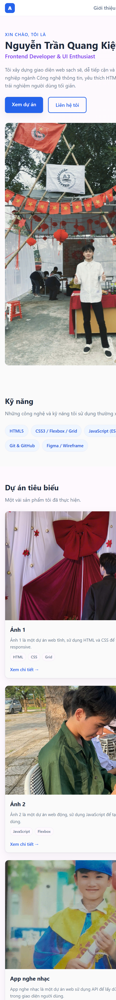
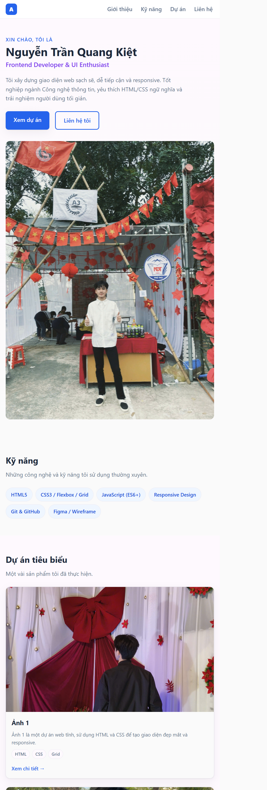
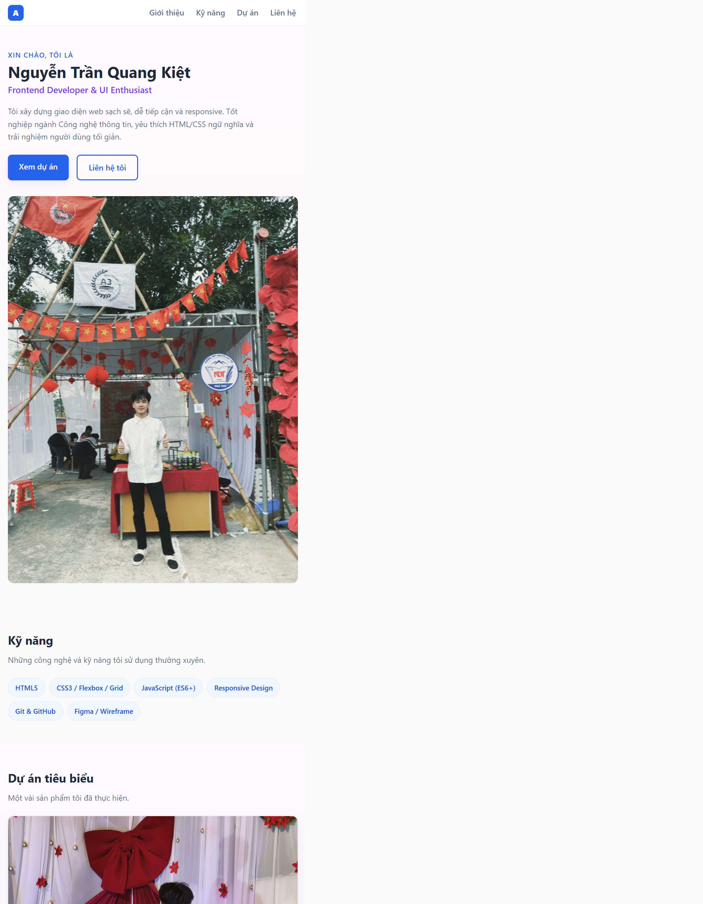

# BÁO CÁO KIỂM THỬ SẢN PHẨM

## 1. Thông tin chung

| Thông tin | Chi tiết |
|---|---|
| Tên dự án | Portfolio CV - Nguyễn Trần Quang Kiệt |
| Phiên bản | v1.0 |
| Ngày kiểm thử | 05/11/2026 |
| Người thực hiện | AI assistant - rà soát tĩnh mã nguồn và tài liệu |
| Người đánh giá/xác nhận | Chưa xác nhận |
| Phạm vi | Website trong `KT A2.1/` và tài liệu bàn giao trong repository |
| Phương pháp | Đối chiếu HTML/CSS, tài liệu và tài nguyên; mở trang trong browser viewport mô phỏng mobile/tablet/desktop; chưa kiểm thử runtime đầy đủ trên các hệ điều hành hoặc thiết bị vật lý |

> **Phạm vi kết luận:** Báo cáo phân biệt rà soát mã nguồn với kiểm thử thực thi. Đã lưu ảnh chụp viewport mô phỏng và đo tràn ngang; việc này không thay thế kiểm thử trên thiết bị vật lý hoặc nhiều trình duyệt.

## 2. Quy ước trạng thái

- **Đạt:** Được xác minh đáp ứng ở phạm vi kiểm tra đã nêu.
- **Chưa đạt:** Đã kiểm tra và xác nhận không đáp ứng yêu cầu.
- **Cần cải thiện:** Còn hạn chế hoặc chưa có đủ kết quả/minh chứng để xác nhận đạt.

## 3. Bảng tổng quan trạng thái

| # | Nhóm tiêu chí | Trạng thái | Tóm tắt |
|---:|---|---|---|
| 1 | Tính đúng đắn và mức độ đáp ứng yêu cầu chức năng | Cần cải thiện | Các mục nội dung và điều hướng chính có trong HTML; liên kết chi tiết dự án vẫn là liên kết mẫu. |
| 2 | Giao diện, trải nghiệm người dùng và khả năng tương thích | Cần cải thiện | Đã chụp và kiểm tra ở viewport 390×844, 768×1024, 1440×900; chưa kiểm thử trên thiết bị vật lý hoặc nhiều trình duyệt. |
| 3 | Khả năng vận hành, xử lý lỗi và hiệu năng cơ bản | Cần cải thiện | Các tài nguyên được tham chiếu đã kiểm tra đều tồn tại; chưa xác minh runtime, lỗi trình duyệt hoặc hiệu năng. |
| 4 | Bảo mật, quản lý cấu hình và dữ liệu | Cần cải thiện | Website là trang tĩnh; liên kết mở tab mới cần bổ sung thuộc tính an toàn và chưa có đánh giá bảo mật chuyên sâu. |
| 5 | Chất lượng mã nguồn, cấu trúc repository và tài liệu bàn giao | Cần cải thiện | Có HTML/CSS và tài liệu hướng dẫn; cần rà soát metadata, nội dung mẫu và hoàn thiện kiểm tra chất lượng. |
| 6 | Khả năng triển khai, kiểm thử và cung cấp minh chứng | Cần cải thiện | Đã lưu ảnh responsive mobile/tablet/desktop; chưa có kết quả triển khai, log runtime hoặc minh chứng kiểm thử các hệ điều hành. |

## 4. Chi tiết kiểm tra

### 4.1 Tính đúng đắn và mức độ đáp ứng yêu cầu chức năng

| Hạng mục kiểm tra | Trạng thái | Ghi chú/Minh chứng |
|---|---|---|
| Có các khu vực Giới thiệu, Kỹ năng, Dự án và Liên hệ | Đạt | Các section với ID `about`, `skills`, `projects`, `contact` có trong `KT A2.1/index.html`. |
| Menu và các nút điều hướng đến đúng section nội bộ | Đạt | Các liên kết neo như `#about`, `#projects`, `#contact` được khai báo trong HTML; chưa kiểm tra thao tác thực tế trên trình duyệt. |
| Hiển thị các thẻ dự án cùng mô tả và hình ảnh | Đạt | Có ba thẻ dự án; các ảnh được tham chiếu (`3.jpg`, `4.jpg`, `5.jpg`, `7.jpg`) tồn tại trong repository. |
| Liên kết “Xem chi tiết” dẫn đến nội dung dự án | Cần cải thiện | Các liên kết hiện dùng `href="#"`, chưa có trang hoặc URL chi tiết. |
| Liên kết mạng xã hội mở đúng đích | Cần cải thiện | Có liên kết TikTok, Instagram và Facebook; chưa xác minh đích liên kết trên trình duyệt. |
| Nội dung và tên dự án đã hoàn thiện cho bàn giao | Cần cải thiện | Một số tên/mô tả còn chung chung như “Ảnh 1”, “Ảnh 2”; cần chủ dự án xác nhận nội dung chính thức. |

### 4.2 Giao diện, trải nghiệm người dùng và khả năng tương thích

| Hạng mục kiểm tra | Trạng thái | Ghi chú/Minh chứng |
|---|---|---|
| Có thiết lập viewport và ngôn ngữ trang | Đạt | HTML khai báo `meta viewport` và `lang="vi"`. |
| CSS có breakpoint cho bố cục responsive | Đạt | `KT A2.1/assets/css/styles.css` có breakpoint `768px` và `1280px`, theo hướng mobile-first. Đây là xác minh mã nguồn, chưa thay thế kiểm thử hiển thị thực tế. |
| Có chỉ báo focus cho điều hướng bàn phím | Đạt | CSS có trạng thái `:focus-visible` và outline; thao tác bàn phím thực tế chưa được kiểm thử. |
| Tôn trọng tùy chọn giảm chuyển động | Đạt | CSS có `prefers-reduced-motion: reduce`. |
| Hiển thị và điều hướng ở viewport mobile 390×844 | Đạt | Đã mở trang bằng browser viewport 390×844 và lưu [ảnh mobile](screenshots/responsive-mobile.png). Các mục menu đều nằm trong chiều rộng nội dung; chưa kiểm tra trên điện thoại vật lý. |
| Hiển thị và điều hướng ở viewport tablet 768×1024 | Đạt | Đã mở trang bằng browser viewport 768×1024 và lưu [ảnh tablet](screenshots/responsive-tablet.png). Bố cục breakpoint tablet được áp dụng; chưa kiểm tra trên máy tính bảng vật lý. |
| Hiển thị và điều hướng ở viewport desktop 1440×900 | Đạt | Đã mở trang bằng browser viewport 1440×900 và lưu [ảnh desktop](screenshots/responsive-desktop.png). Bố cục breakpoint desktop được áp dụng; chưa kiểm tra trên máy tính vật lý. |
| Không có tràn ngang ở các viewport đã chụp | Đạt | Đo `document.documentElement.scrollWidth` và `clientWidth`: mobile 375/375, tablet 753/753, desktop 1425/1425 (browser có vùng scrollbar). Các liên kết điều hướng nằm trong vùng hiển thị ở cả ba kích thước. |
| Ảnh có văn bản thay thế phù hợp | Cần cải thiện | Ảnh đại diện có alt mô tả; alt ảnh dự án còn chung chung như “Ảnh 1”. |
| Tương thích trên các trình duyệt mục tiêu | Cần cải thiện | Chưa kiểm thử trên Chrome, Edge, Firefox, Safari hoặc thiết bị thực. |

#### Ảnh minh chứng responsive

Ảnh được chụp từ browser ở các kích thước viewport mô phỏng; đây không phải ảnh chụp thiết bị vật lý.

**Mobile - 390×844**

**Tablet - 768×1024**

**Desktop - 1440×900**

### 4.3 Khả năng vận hành, xử lý lỗi và hiệu năng cơ bản

| Hạng mục kiểm tra | Trạng thái | Ghi chú/Minh chứng |
|---|---|---|
| Đường dẫn stylesheet tồn tại | Đạt | HTML liên kết `./assets/css/styles.css`; file CSS có trong repository. |
| Các tệp ảnh được tham chiếu tồn tại | Đạt | Đã kiểm tra sự tồn tại của `3.jpg`, `4.jpg`, `5.jpg`, `7.jpg`. |
| Trang tải thành công qua máy chủ tĩnh | Cần cải thiện | README có hướng dẫn chạy bằng Python nhưng chưa ghi nhận kết quả chạy thực tế. |
| Không có lỗi console hoặc tài nguyên khi tải trang | Cần cải thiện | Chưa kiểm tra Developer Tools/Network hoặc log runtime. |
| Có xử lý và thông báo khi tài nguyên bị thiếu | Cần cải thiện | Chưa có kiểm thử tình huống lỗi; website tĩnh không có cơ chế thông báo lỗi tài nguyên riêng được xác minh. |
| Hiệu năng tải trang và hình ảnh đáp ứng yêu cầu | Cần cải thiện | Chưa đo thời gian tải, Lighthouse, Web Vitals hoặc kích thước trang. |

### 4.4 Bảo mật, quản lý cấu hình và dữ liệu

| Hạng mục kiểm tra | Trạng thái | Ghi chú/Minh chứng |
|---|---|---|
| Không thấy luồng backend hoặc gửi biểu mẫu trong phạm vi trang | Đạt | Trang được xây dựng như website tĩnh; đây chỉ là rà soát mã nguồn được kiểm tra, không phải đánh giá bảo mật toàn repository. |
| Yêu cầu cấu hình môi trường được tài liệu hóa | Đạt | README nêu dự án không cần `.env` hoặc cấu hình riêng. |
| Liên kết mở tab mới có thuộc tính an toàn | Cần cải thiện | Các liên kết mạng xã hội dùng `target="_blank"` nhưng chưa có `rel="noopener noreferrer"`. |
| URL bên ngoài đã được xác minh và phê duyệt | Cần cải thiện | Chưa xác minh đích đến và chính sách của các nền tảng bên ngoài. |
| Đã quét bí mật và đánh giá bảo mật chuyên sâu | Cần cải thiện | Chưa có kết quả quét bí mật hoặc kiểm thử bảo mật chuyên sâu. |
| Image/cấu hình triển khai Docker đã được ghim phiên bản | Cần cải thiện | README sử dụng `nginx:alpine` mà không ghim phiên bản cụ thể; chưa xác minh quy trình triển khai. |

### 4.5 Chất lượng mã nguồn, cấu trúc repository và tài liệu bàn giao

| Hạng mục kiểm tra | Trạng thái | Ghi chú/Minh chứng |
|---|---|---|
| HTML và CSS được tách thành các tệp riêng | Đạt | `index.html` liên kết đến `assets/css/styles.css`. |
| Tài nguyên được sắp xếp theo thư mục | Đạt | Có thư mục riêng cho CSS và hình ảnh trong `KT A2.1/assets/`. |
| Metadata tác giả đầy đủ | Cần cải thiện | `meta author` trong HTML hiện chỉ ghi `Nguyễn Trần `, chưa đầy đủ tên. |
| Nội dung nhận diện thương hiệu đã hoàn thiện | Cần cải thiện | Phần tử `.brand-name` trong header hiện rỗng. |
| Nội dung mẫu và mã HTML comment đã được rà soát | Cần cải thiện | Có nội dung dự án chung và một khối thẻ dự án được comment ở cuối HTML; cần xác nhận có nên giữ khi bàn giao. |
| README và release note có hướng dẫn/phạm vi dự án | Đạt | Có `README.md` và `docs/RELEASENOTE.md`; README nêu cách chạy cục bộ và Docker. |
| Có validator/linter/kiểm tra accessibility tự động | Cần cải thiện | Chưa có cấu hình hoặc kết quả chạy validator HTML, CSS lint, accessibility hay CI trong phạm vi rà soát. |

### 4.6 Khả năng triển khai, kiểm thử và cung cấp minh chứng

| Hạng mục kiểm tra | Trạng thái | Ghi chú/Minh chứng |
|---|---|---|
| Có hướng dẫn chạy máy chủ cục bộ | Đạt | README cung cấp lệnh Python HTTP server cho Windows, macOS và Linux. |
| Có hướng dẫn chạy bằng Docker | Đạt | README có lệnh Nginx, ánh xạ cổng `8080` và lệnh dừng container. |
| Website đã được chạy xác nhận bằng Docker | Cần cải thiện | Chưa có kết quả chạy container hoặc xác nhận truy cập `http://localhost:8080`. |
| Đã kiểm thử trên Windows, macOS và Linux | Cần cải thiện | Có hướng dẫn cho các hệ điều hành nhưng chưa có biên bản chạy thực tế. |
| Có ảnh chụp responsive mobile/tablet/desktop | Đạt | Đã lưu ba ảnh viewport mô phỏng trong `docs/screenshots/` và nhúng vào mục 4.2. Thư mục cũ `docs/screenshorts/` bị viết sai chính tả, đang trống và không dùng làm minh chứng. |
| Có log triển khai, kết quả console/network hoặc số liệu hiệu năng | Cần cải thiện | Chưa lưu log Docker, kết quả console/network hoặc số liệu hiệu năng. |
| Có thể lặp lại quy trình kiểm thử | Cần cải thiện | Cần ghi lại môi trường, phiên bản trình duyệt, kích thước viewport, bước kiểm tra và kết quả cho mỗi lần chạy. |

## 5. Đánh giá tổng kết và đề xuất

### Nhận định chung

Mã nguồn có các khu vực nội dung và điều hướng chính, stylesheet riêng, breakpoint responsive, hỗ trợ focus/reduced-motion và tài nguyên hình ảnh được tham chiếu có tồn tại. Tài liệu bàn giao đã mô tả cách chạy cục bộ và Docker.

Chưa đủ minh chứng để xác nhận sản phẩm sẵn sàng bàn giao chính thức. Đã chụp và lưu minh chứng browser viewport cho mobile, tablet và desktop; tuy nhiên chưa kiểm thử trên thiết bị vật lý hoặc nhiều trình duyệt, và chưa có kết quả triển khai/runtime đầy đủ. Các trạng thái “Cần cải thiện” phản ánh giới hạn hoặc thiếu minh chứng, không đồng nghĩa tất cả hạng mục đã được chạy và thất bại.

### Đề xuất trước khi bàn giao

1. Kiểm tra lại responsive trên thiết bị vật lý và các trình duyệt mục tiêu; ảnh hiện có là browser viewport mô phỏng, không đại diện cho mọi thiết bị.
2. Thay liên kết dự án dạng `#` bằng liên kết thật hoặc điều chỉnh nhãn/nội dung để không gây hiểu nhầm.
3. Hoàn thiện metadata tác giả, tên thương hiệu và nội dung dự án; bổ sung `rel="noopener noreferrer"` cho liên kết mở tab mới.
4. Chạy website cục bộ và Docker, kiểm tra console/network, xác nhận liên kết ngoài và ghi lại kết quả.
5. Chạy kiểm tra hiệu năng/accessibility cơ bản, lưu minh chứng, rồi cập nhật trạng thái tổng quan theo kết quả thực tế.

### Xác nhận bàn giao

- [x] Đã kiểm thử responsive ở browser viewport 390×844, 768×1024, 1440×900 và lưu ảnh minh chứng trong `docs/screenshots/`.
- [ ] Đã kiểm thử trên trình duyệt/thiết bị mục tiêu.
- [ ] Đã xác nhận triển khai Docker nếu thuộc phạm vi bàn giao.
- [ ] Đã xử lý hoặc chấp thuận các hạn chế còn lại.
- [ ] Đã lưu minh chứng và được người phụ trách xác nhận.

**Kết luận hiện tại:** Chưa xác nhận bàn giao; minh chứng responsive ở viewport mô phỏng đã có, nhưng cần hoàn tất kiểm thử thiết bị/trình duyệt mục tiêu và các bước triển khai trước khi phê duyệt.